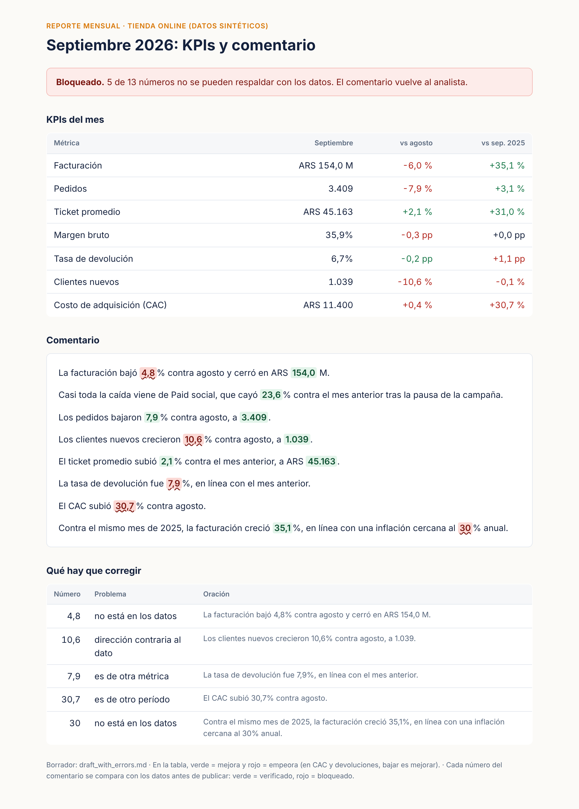

# AI KPI commentary, with every number checked

**A monthly KPI report where an LLM drafts the commentary and a checker verifies every number against the data before anyone reads it. If a single number cannot be backed by the data, the report is blocked.**

*Versión en español más abajo. The sample report itself is in Spanish, written for an Argentine online retailer (fictional).*



## Why

LLMs write good first drafts of a monthly commentary, and they also do the things that make finance teams stop trusting a report: a figure that is close but not right, the year-on-year number quoted as month-on-month, "grew" where the data says it fell, a rate borrowed from the next metric, or an outside figure ("inflation of about 30 %") that nobody sourced. Reading every sentence against the KPI table by hand defeats the point of automating the draft.

## How it works

1. **Facts first.** [`kpis.py`](src/kpicheck/kpis.py) computes the month's KPIs from the raw orders and marketing spend: revenue, orders, average ticket, gross margin, return rate, new customers and CAC, each against the previous month and the same month last year, plus revenue by channel. These numbers are the only source of truth.
2. **Draft.** The LLM receives only the facts (JSON) and a short instruction ([`draft.py`](src/kpicheck/draft.py)).
3. **Check.** [`verify.py`](src/kpicheck/verify.py) reads the draft sentence by sentence and checks every number:
   - **exists:** it equals a fact once the fact is rounded to the decimals the text shows (Argentine format, 1.234,5);
   - **right metric:** if the sentence names a metric, the number belongs to that metric;
   - **right period:** "contra agosto" must quote a month-on-month value, "contra el mismo mes de 2025" a year-on-year one;
   - **right direction:** "subió" cannot sit next to a change that is negative.
4. **Release gate.** The HTML report shows every number in green (verified) or red (blocked, with the reason). The command exits with an error if anything is red, so it can sit in a scheduled job or a CI step.

## Example

Two drafts are included so it runs without an API key: [`draft_ok.md`](examples/draft_ok.md) and [`draft_with_errors.md`](examples/draft_with_errors.md), which plants the five mistakes above.

```text
$ python run.py --draft examples/draft_ok.md
18 numbers checked, 0 problems -> RELEASED

$ python run.py --draft examples/draft_with_errors.md
13 numbers checked, 5 problems -> BLOCKED
  NOT_FOUND             4,8  | La facturación bajó 4,8% contra agosto ...
  WRONG_DIRECTION      10,6  | Los clientes nuevos crecieron 10,6% contra agosto ...
  WRONG_METRIC          7,9  | La tasa de devolución fue 7,9% ...
  WRONG_PERIOD         30,7  | El CAC subió 30,7% contra agosto.
  NOT_FOUND              30  | ... una inflación cercana al 30% anual.
```

The released version: [`output/report_released.png`](output/report_released.png).

## Run it

```bash
pip install -r requirements.txt
python scripts/generate_data.py                      # synthetic orders (seeded)
python run.py --draft examples/draft_ok.md           # check a saved draft
python -m pytest -q                                  # 4 tests

# with a live LLM draft (needs the anthropic package and an API key)
export ANTHROPIC_API_KEY=...  ANTHROPIC_MODEL=...    # model name from the provider's docs
python run.py --llm
```

## Limits, stated plainly

The checker proves that each number in the text exists in the data for the metric and period the sentence names. It does not judge whether the explanation is the right one; that is still the analyst's job, and the reason the report has a human owner.

## Data

Synthetic: about 47,000 orders of a fictional online store, September 2025 to September 2026, with a paid-social campaign paused in the last month so there is a story to tell.

---

## Versión en español

**Un reporte mensual de KPIs en el que un LLM redacta el comentario y un control verifica cada número contra los datos antes de publicarlo. Si un solo número no se puede respaldar, el reporte queda bloqueado.**

**Por qué.** Los LLM escriben buenos primeros borradores, pero también cometen los errores que hacen que finanzas deje de confiar en un reporte: una cifra parecida pero no exacta, el interanual citado como mensual, "creció" cuando el dato cayó, el número de otra métrica, o un dato externo sin fuente. Revisar oración por oración a mano anula el beneficio de automatizar.

**Cómo funciona.** Primero se calculan los KPIs del mes (la única fuente de verdad). El LLM recibe solo esos datos y redacta. Después, cada número del texto se valida: que exista en los datos con el redondeo que muestra, que sea de la métrica que nombra la oración, del período que dice ("contra agosto" o "contra el mismo mes de 2025") y que el verbo ("subió", "cayó") coincida con el signo. El reporte HTML marca cada número en verde o en rojo, y el proceso termina con error si hay alguno en rojo.

**Límite.** El control asegura que los números son correctos; si la explicación es la acertada lo sigue decidiendo el analista.

**Datos.** Sintéticos: unas 47.000 órdenes de una tienda online ficticia.

---

Pablo Pavón · Senior Business & Data Analyst · [pablodpavon.github.io](https://pablodpavon.github.io)
